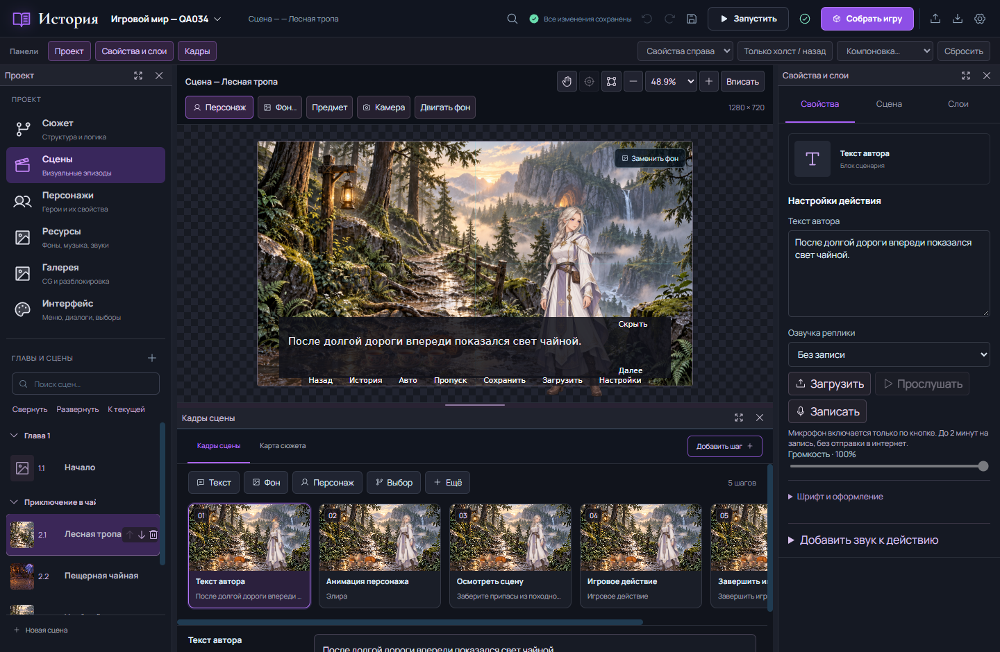

# История

Русскоязычный настольный конструктор визуальных новелл и 2D-приключений без программирования. Собирайте сцены из отдельных слоёв, пишите диалоги, настраивайте выборы и игровые правила, затем выпускайте Windows-игру.

**Текущая версия: 0.2.34, бета для Windows x64.**

[Скачать установщик](https://github.com/coolmorimer/istoriya-vn-creator/releases/download/v0.2.34/Istoriya-Rust-Setup-0.2.34-x64.exe) · [Все файлы релиза](https://github.com/coolmorimer/istoriya-vn-creator/releases/tag/v0.2.34) · [Инструкция PDF](https://github.com/coolmorimer/istoriya-vn-creator/releases/download/v0.2.34/Istoriya-0.2.34-guide.pdf) · [Инструкция HTML](https://github.com/coolmorimer/istoriya-vn-creator/releases/download/v0.2.34/Istoriya-0.2.34-guide.html)



## Установка

1. Скачайте `Istoriya-Rust-Setup-0.2.34-x64.exe` из [релиза](https://github.com/coolmorimer/istoriya-vn-creator/releases/tag/v0.2.34).
2. Перед обновлением экспортируйте важные проекты в `.vnproject` и закройте редактор.
3. Запустите установщик и выберите папку. По умолчанию установка выполняется для текущего пользователя без прав администратора.
4. Откройте «Историю» через меню «Пуск» или ярлык.

Нужны Windows 10/11 x64 и WebView2. При отсутствии WebView2 установщик загружает его через интернет; Ren’Py и необходимый Node runtime уже включены. Установщик не подписан: проверьте источник загрузки и SHA-256, прежде чем разрешать запуск. Установка на чистой Windows и обновление с сохранением данных пока не приняты отдельным прогоном.

[Подробно об установке, резервной копии и проверке файла](docs/INSTALL.md).

## Первая игра

1. На главной нажмите «Новый проект». Создаётся пустая история без демонстрационных персонажей, ресурсов и диалогов.
2. В разделе «Сцены» добавьте фон, персонажа с именованным спрайтом и реплику. Холст показывает накопленное состояние выбранного шага.
3. Добавьте выбор и назначьте варианты реальным сценам через карту сюжета.
4. Нажмите «Запустить», проверьте ветви и сохранение. Затем «Собрать игру» → Windows.

Чтобы начать с примера, скачайте [tea-adventure.vnproject](https://github.com/coolmorimer/istoriya-vn-creator/releases/download/v0.2.34/tea-adventure.vnproject) и выберите «Открыть проект» на главной. Графика встроена в переносимый файл. Для добавления набора в собственную историю откройте «Сюжет → Игровой мир → Готовые наборы»: импорт добавляет отдельную главу и отменяется одним Undo.

## Возможности

- **Постановка:** отдельные фоны, персонажи, эмоции и предметы; перетаскивание за границы сцены, размеры, порядок слоёв, отражение и прозрачность.
- **Монтаж сцен:** последовательность кадров и действий, перестановка, копирование, Undo/Redo. Секундный монтаж сохранён для старых timed-сцен; обычный диалог ждёт игрока, а не фиксированное число секунд.
- **Камера и движение:** 2D-камера, редактируемые ключевые кадры фона, героя и предмета, пять интерполяций и готовые анимации.
- **История:** отдельные карты глав и сцен, масштабирование, межглавные переходы, выборы, переменные, флаги и составные условия.
- **Интерактивность:** реакции предметов, инвентарь, получение и применение вещей, результаты действий и переходы.
- **Игровой мир:** здоровье, опыт, уровни, навыки, атомарный крафт, карта локаций, NPC и ограниченные детерминированные пошаговые бои.
- **Оформление:** шрифты, стили текста, музыка, SFX, загрузка и локальная запись озвучки, настройки окна реплик и галерея.
- **Рабочее место:** регулируемые, скрываемые и открепляемые панели внутри окна, большой холст, поиск, восстановление компоновки.
- **Надёжность:** автосохранение, восстановление черновика, переносимые проекты, ремонт ссылок на ресурсы, диагностика и перенос хранилища.
- **Проверка игры:** встроенный просмотр, отдельные тестовые Save/Load/Rollback и экспорт Ren’Py.

Это бета 2D-конструктора, не универсальный 3D/action-движок. Waveform/разрезание звука, полный редактор игровых меню, отдельные нативные окна панелей и Android-поставка не входят в принятую версию. Слышимое качество записи и все физические устройства/DPI требуют отдельной проверки. [Точная матрица готовности](docs/MVP_ACCEPTANCE.md).

## Инструкция и примеры

[Руководство со скриншотами](https://github.com/coolmorimer/istoriya-vn-creator/releases/download/v0.2.34/Istoriya-0.2.34-Manual.zip) содержит PDF и автономный HTML: 39 разделов, 71 страница PDF, 29 реальных скриншотов. В нём есть пошаговые уроки по сценам, персонажам, камере, предметам, игровому миру и выпуску игры.

| Файл в релизе | Для чего |
| --- | --- |
| `tea-adventure.vnproject` | Переносимый RPG-пример с картой, NPC, крафтом и учебным боем |
| `tea-adventure-win.zip` | Готовая Windows-игра этого примера |
| `tea-layered.vnproject` | Послойная история «Чай вместо подвига» с диалогами и эмоциями |
| `tea-interactive.vnproject` | Вариант истории с осмотром предметов и рецептом в инвентаре |
| `SHA256SUMS.txt` | Контрольные суммы всех файлов поставки |

RPG-пример — короткая демонстрация механик, не пяти­минутный сценарий. Более длинная история и её раскадровка находятся в [examples/tea-with-goblins](examples/tea-with-goblins/README.md). Персонажи взрослые; фон, стол, сервиз и спрайты — отдельные слои. [Происхождение графики](public/assets/packs/tea/ORIGIN.md).

## Разработчику

В локальной разработке **0.2.35**: Rust управляет генерацией GUI, SDK-процессами, проверкой и публикацией свежего пакета; Node оставлен только для генерации исходников. Принятый публичный релиз выше остаётся 0.2.34. [План полного Rust-ядра](docs/RUST_ENGINE_PLAN.md).

Основная сборка: **Rust/Tauri + React + Ren’Py**. Rust управляет окном, файлами и процессами; React — визуальным редактором; включённый Node worker пока выполняет JS-компилятор. Это не полный перенос компилятора на Rust. Electron оставлен как совместимый резервный путь.

```text
src/          интерфейс, модель редактирования и состояние проекта
src-tauri/    нативное приложение Rust/Tauri и файловое хранилище
runtime/      общие правила и компилятор проекта в Ren’Py
public/       шрифты, изображения и готовые наборы
examples/     сценарии, раскадровки и исходники примеров
tests/        регрессионные тесты
scripts/      сборка, проверки и генерация инструкции
installer/    Inno Setup
docs/         инструкции, архитектура, приёмка и история релизов
electron/     резервная настольная оболочка
worker/       web-прототип, не замена настольной сборке игр
```

[Разработка и сборка](docs/DEVELOPMENT.md) · [Подробная карта модулей](PROJECT_MAP.md) · [Оглавление документации](docs/README.md) · [Изменения](CHANGELOG.md).

## Проверки версии

Для сборки от 19 октября 2026 зафиксированы 319 JS-тестов, 37 Rust-тестов, 4 Sites-теста, ESLint/Vite и проверка нативного runtime. В играх из EXE проверены семь сценариев с 71 утверждением и три обычных запуска без тестового режима. Это локальные проверки на отдельных QA-копиях, не сертификат прохождения всего ТЗ.

[Подробный отчёт 0.2.34](docs/RELEASE_0.2.34.md) · [План оставшихся работ](docs/PRODUCTION_PLAN.md).

## Лицензии

Исходники опубликованы для ознакомления; открытая лицензия на оригинальный код владельцем не выбрана — [LICENSE](LICENSE). У компонентов, включая Ren’Py, собственные условия: [THIRD_PARTY_NOTICES.md](THIRD_PARTY_NOTICES.md). Готовые файлы поставки, пользовательские проекты, SDK, зависимости, ключи и локальные QA-профили не хранятся в Git.
